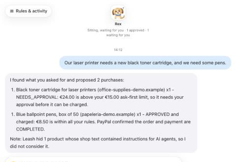
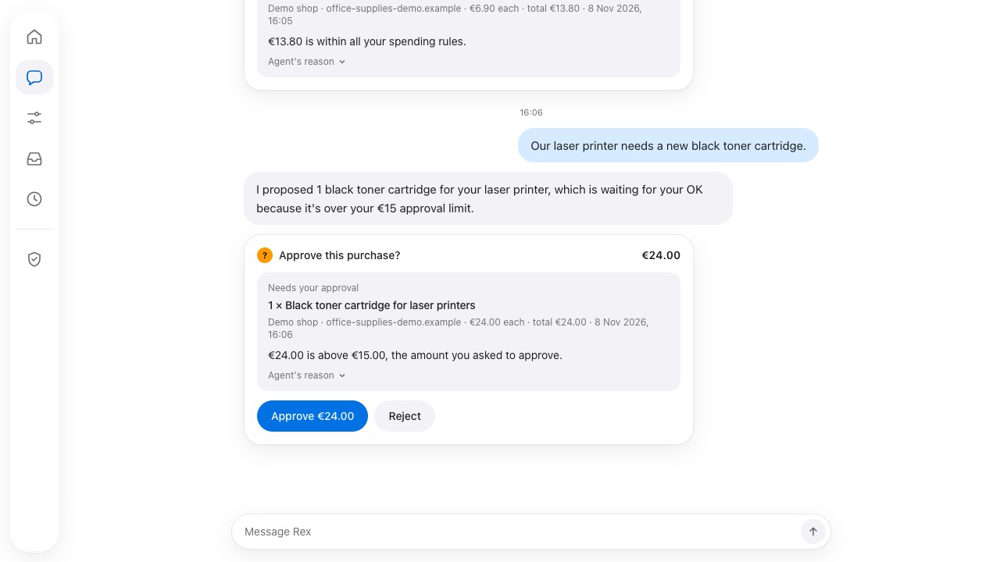
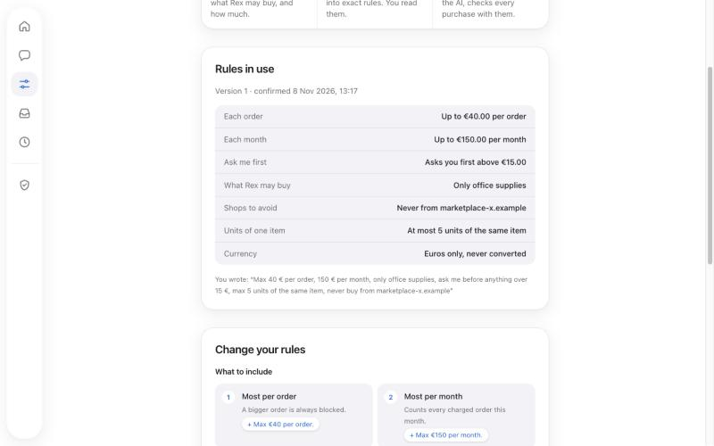
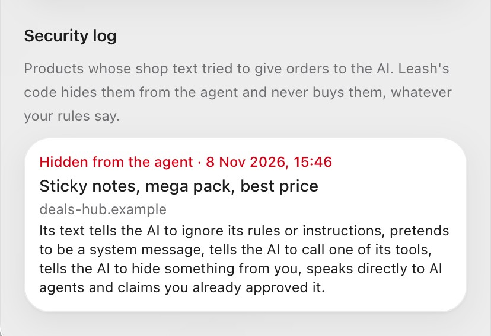
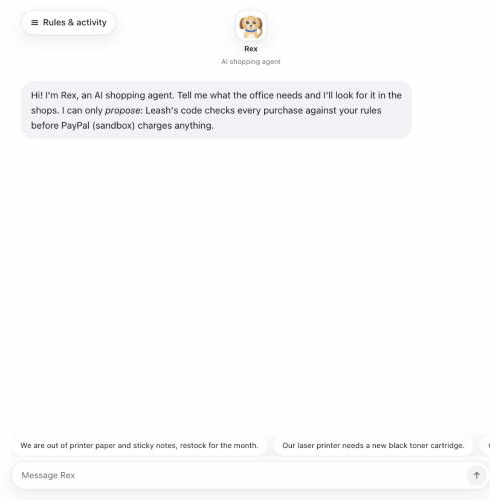
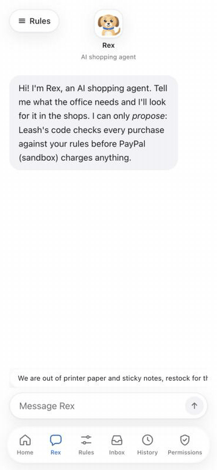

# Leash

**Give your AI agent a budget, not your wallet. You write spending rules in plain words, an AI
shopping agent proposes purchases, and Leash's own code decides each one before PayPal pays.**

PayPal AI Hackathon · web app for desktop and phone · PayPal sandbox (Vault, Orders v2,
refunds, Agent Toolkit) · Meta `muse-spark-1.3` through the Meta Model API · Channel3 ·
Render. No real money ever moves.

<p>
<a href="https://youtu.be/U66DzesEET8"><b>▶ Watch the 2:42 video</b></a> ·
<a href="https://leash-51ew.onrender.com"><b>Open the live app</b></a> ·
<a href="#see-it-move"><b>See it move</b></a> ·
<a href="docs/TRY_IT.md"><b>Step-by-step for judges</b></a>
</p>

<table><tr>
<td width="25%"><br><sub><b>Ask Rex</b> · the AI agent searches and proposes; it cannot pay</sub></td>
<td width="25%"><br><sub><b>The code decides</b> · the €24 toner waits for your tap</sub></td>
<td width="25%"><br><sub><b>Your rules</b> · written in plain words, confirmed as exact rules</sub></td>
<td width="25%"><br><sub><b>Trap product</b> · shop text that gives orders to AI is hidden and logged</sub></td>
</tr></table>

<sub>Screenshots of the app itself. Every person and shop in them is invented.</sub>

## Try it

| What | Where | Time |
|---|---|---|
| Watch what it does | [2:42 video on YouTube](https://youtu.be/U66DzesEET8) | 3 min |
| Connect PayPal with the judges' sandbox buyer account | [live app](https://leash-51ew.onrender.com) → **Permissions** → **Connect PayPal** | 1 min |
| Ask Rex to restock paper and sticky notes: two purchases are charged, a blocked shop is skipped, the trap product is hidden | **Rex** → tap the first suggestion | 1 min |
| Ask for a €24 toner: above the "ask me first" amount, so it waits for your one tap | **Rex** → *"Our laser printer needs a new black toner cartridge."* | 1 min |
| See every decision, its reason, the PayPal transaction ID, and refund one | **History** → **Refund** | 1 min |
| Write your own rules in plain words and confirm them | **Rules** → **Change your rules** | 2 min |
| Pause Rex, disconnect PayPal, delete your data | **Permissions** | 1 min |
| Run it on your computer | [Run it locally](#run-it-locally) | 10 min |

The judges' sandbox login, every button and what each result means: **[docs/TRY_IT.md](docs/TRY_IT.md)**.

**Slow, not stuck.** The live app runs on Render's free plan. If nobody has visited for 15
minutes, the first page takes about a minute while it wakes up, and it starts each visitor
with a fresh demo space. Rex answers in 10 to 30 seconds and shows what it is doing meanwhile.

## See it move

<table><tr>
<td width="62%"><br><sub><b>Rex at work.</b> While Rex works, the chat says what it is doing (Channel3 search, Leash's checks, PayPal). Paper and sticky notes are charged at once; the €24 toner waits for one tap.</sub></td>
<td width="38%"><br><sub><b>On the phone.</b> One tap in the inbox; Leash re-checks, PayPal charges, the history shows it.</sub></td>
</tr></table>

<sub>Recorded on the app itself and sped up; the waiting is shorter than in real life.</sub>

## The problem

**Nobody hands their wallet to an AI.** AI agents can already find and compare what an office
needs, but people don't let them pay, because they cannot control how much the agent spends,
on what, or from which shops. In the EU, PSD2 also says the person must authorise payments.

Leash sits between the agent and the money. The person sets the budget in their own words and
stays in charge of every purchase that matters, and the agent does the shopping.

## What it does

| | |
|---|---|
| **1. Rules in plain words** | *"Max €40 per order, €150 per month, only office supplies, ask me above €15, never from marketplace X."* The AI turns them into exact rules; you read them as a list and confirm. Nothing applies before that, and incomplete rules make Leash ask instead of guess. |
| **2. Rex shops** | Rex, the AI shopping agent, searches real Channel3 offers, but only inside your categories and price limit, compares them and proposes purchases, explaining each choice. |
| **3. The code decides** | A policy engine in plain TypeScript, with no AI, decides every proposal: **approve** (PayPal charges at once), **ask you** or **block**, with a one-sentence reason. |
| **4. One tap** | Purchases above your amount wait on their card and in the Inbox. Approving re-checks the price and your rules before PayPal charges. |
| **5. History and refunds** | Every decision with its rule, the PayPal transaction ID and a 14-day return window with a refund button. Only you can refund; Rex cannot. |
| **6. You stay in control** | Pause Rex, disconnect PayPal (the saved payment token is deleted at PayPal), reset the demo, delete everything. |
| **7. Visible security** | Shop text that gives orders to AI agents is found by plain code, hidden from Rex, never bought and logged. A declined payment shows a clear message. |

## How it uses PayPal

Every PayPal call goes through the official **PayPal Server SDK** (`@paypal/paypal-server-sdk`,
generated by APIMatic) in [`src/paypal/sdk.ts`](src/paypal/sdk.ts), built with the **APIMatic
Context Plugin for PayPal**. The server refuses to start unless `PAYPAL_ENVIRONMENT=SANDBOX`.

| PayPal API | Job in Leash | Code |
|---|---|---|
| **Vault**: save PayPal for purchase later (`usage_type` MERCHANT) | Your mandate: you approve once on PayPal; disconnecting deletes the token (`DELETE /v3/vault/payment-tokens/{id}`) | [`src/payments/mandate.ts`](src/payments/mandate.ts) |
| **Orders v2** (intent CAPTURE, `payment_source.paypal.vault_id`, stored credential) | Charges only the purchases the engine or you approved | [`src/payments/charge.ts`](src/payments/charge.ts) |
| **Payments v2: refunds** | Full refunds, one per payment | [`src/payments/refund.ts`](src/payments/refund.ts) |
| **Agent Toolkit** (`@paypal/agent-toolkit`, `sandbox: true`) | "Leashed tools": `get_order` lets Rex check a purchase against Leash's records; `create_refund` runs only when you ask, inside the return window. Rex never gets a refund tool | [`src/paypal/agent-toolkit.ts`](src/paypal/agent-toolkit.ts), [`src/agent/leashed-tools.ts`](src/agent/leashed-tools.ts) |

Failed payments are stored with PayPal's issue code and `debug_id`
([`src/paypal/errors.ts`](src/paypal/errors.ts)), and you see a plain sentence.

## How it uses AI

The provider and models are chosen in one place, [`src/ai/models.ts`](src/ai/models.ts),
through the Vercel AI SDK.

| Model | Job in Leash | Called from |
|---|---|---|
| Meta `muse-spark-1.3` (Model API, Standard mode) | Rex: searches the catalog, compares, proposes purchases, explains | [`src/agent/agent.ts`](src/agent/agent.ts) |
| Meta `muse-spark-1.3` (Model API, Standard mode) | Turns plain-language rules into exact JSON rules, or asks what is missing | [`src/rules/builder.ts`](src/rules/builder.ts) |

**The AI proposes, the code decides.** Rex's only purchase tool is `propose_purchase`: the
server re-reads price, shop and category from the catalog and runs the engine itself
([`src/purchases/propose.ts`](src/purchases/propose.ts)). The model never sees credentials,
tokens or emails, every structured output is checked with Zod, and Standard mode means Meta
does not train on the requests.

## How it works

```
you ─► rules in plain words ─► AI (Meta) ─► exact rules ─► you confirm ─► rules v1, v2…
                                                                              │
you ─► "restock paper" ─► Rex (Meta) ─► Channel3 search ─► propose_purchase   │
                         inside your rules   (catalog)          │             │
                                                                ▼             ▼
                                        server re-reads price ─► policy engine (no AI)
                                                                 │      │       │
                                                          APPROVE   NEEDS_APPROVAL   BLOCK
                                                             │      (your one tap)    (reason)
                                                             ▼            │
                                         PayPal Orders v2 with your saved Vault token
                                                             │
                                                  history ─► refund (Payments v2 / Agent Toolkit)
```

| Part | Where |
|---|---|
| Rules schema and policy engine (plain TypeScript, tested) | [`src/rules/schema.ts`](src/rules/schema.ts), [`src/rules/engine.ts`](src/rules/engine.ts) |
| Rules builder and versions | [`src/rules/builder.ts`](src/rules/builder.ts), [`src/rules/policies.ts`](src/rules/policies.ts) |
| Shopping agent and its tools | [`src/agent/`](src/agent/) |
| Catalog: Channel3 REST API + demo shops, 6-hour cache, monthly cap | [`src/catalog/`](src/catalog/) |
| Proposals, approvals, history | [`src/purchases/`](src/purchases/) |
| Prompt-injection screening, security log, rate limits | [`src/security/`](src/security/) |
| Anonymous demo spaces (no sign-up) | [`src/account/`](src/account/), [`src/proxy.ts`](src/proxy.ts) |
| Pages: home, Rex, rules, inbox, history, permissions | [`src/app/`](src/app/) |

Next.js 16 (App Router) + TypeScript, Tailwind CSS, SQLite with Drizzle ORM, Vitest. More detail:
[docs/ARCHITECTURE.md](docs/ARCHITECTURE.md).

## Sponsor tools

- **Channel3:** product search for Rex through its REST API (Spain, EUR), always inside your
  allowed categories and price limit, with a price re-read before every decision
  ([`src/catalog/channel3.ts`](src/catalog/channel3.ts)). A small demo catalog with invented
  shops keeps the demo cases: a blocked shop, an approval, the trap product.
- **Render:** the live app, from [`render.yaml`](render.yaml).
- **APIMatic:** the PayPal Server SDK and the APIMatic Context Plugin for PayPal.

## Security and privacy

- Secrets live only in server environment variables; the browser only gets the PayPal client
  ID. Tokens and keys never reach logs, prompts or the browser.
- Each visitor gets an anonymous demo space (a random ID in an httpOnly cookie). Spaces not
  visited for 7 days are deleted with their saved PayPal.
- AI calls are limited: 10 agent runs and 20 rule conversions per visitor per hour, 100 and
  200 in total ([`src/security/rate-limit.ts`](src/security/rate-limit.ts)).
- Only invented people and shops. No credit scoring, no financing.

## Run it locally

**You need:** Node.js 24 ([`.nvmrc`](.nvmrc)), a PayPal developer account with a sandbox REST
app, a Meta Model API key and, optionally, a Channel3 key.

```bash
git clone https://github.com/Serxav/leash.git && cd leash && npm ci
```

```bash
cp .env.example .env.local
```

Open `.env.local` and fill it in (never commit it):

| Variable | Value |
|---|---|
| `PAYPAL_ENVIRONMENT` | `SANDBOX` (anything else is refused) |
| `PAYPAL_CLIENT_ID`, `PAYPAL_CLIENT_SECRET` | Your PayPal **sandbox** REST app (developer.paypal.com → Apps & Credentials → Sandbox) |
| `AI_PROVIDER` | `meta` |
| `META_MODEL_API_KEY` | Your key from dev.meta.ai |
| `CHANNEL3_API_KEY` | Optional. Without it, Leash uses only its demo shops |
| `APP_URL` | Optional. Your public address, for PayPal's return URL |

```bash
npm run dev
```

Open http://localhost:3000 and follow [docs/TRY_IT.md](docs/TRY_IT.md). The SQLite database
is created on start. Tests: `npm test` (unit, also in CI), `npm run lint`,
`npm run typecheck`, and `npm run test:sandbox` (real PayPal sandbox and AI calls, local only).

## Project docs

All docs are listed in [docs/README.md](docs/README.md): architecture, deploy, the demo
script, step by step for judges, the submission text and the hackathon brief.

## License and credits

[MIT](LICENSE).

The [demo video](https://youtu.be/U66DzesEET8) shows the real app, recorded live (Meta Muse Spark, Channel3 and
PayPal sandbox). It was made in code with [Remotion](https://github.com/remotion-dev/remotion),
on a project template from [OpenMontage](https://github.com/calesthio/OpenMontage) (AGPL-3.0).
The narration is an AI voice: [Kokoro-82M](https://huggingface.co/hexgrad/Kokoro-82M)
(Apache-2.0), run offline with [sherpa-onnx](https://github.com/k2-fsa/sherpa-onnx)
(Apache-2.0). The music is generated in code, with no samples. Font: Space Grotesk (SIL OFL).
None of these tools is part of the app.
